<!-- 原 PDF 第 1 页 -->

# 从水量平衡到 SCS-CN：一个闭合关系是怎样构造出来的？

面向学生的建模逻辑讲义。主线：预测径流的目标 → 水量守恒与参数化 → Buckingham π 定理 → 未知曲面与固定参数下的未知径流曲线 → 径流和滞蓄的等价表达 → 形状约束 → 构造 SCS-CN → 滞蓄增长规律的解释与检验 → Bartlett 的空间平均解释。

本文是一条为教学重建的逻辑路线，不是 Mockus 发明模型的历史实录。文中的有理函数选择、微分方程族和变分目标是帮助理解的数学构造，不应当被表述成已经证实的唯一产流机制。

## 一、先提出问题：知道下了多少雨，能算出多少径流吗？

假设我们面对一个流域，希望预测一次降雨事件产生的直接径流总量。先不预测洪峰、流量过程或到达出口的时刻，把问题限定为事件总水量的分配。

所有水量统一表示为流域单位面积上的等效水深，单位可以选 mm。这样不同面积的流域可以用相同的量纲表达。

这里的“滞蓄”是事件水量划分中的量。不要一开始就把 $F$ 当成某一时刻实测的土壤储水增量，也不要直接把 $S$ 当成土壤孔隙总体积；建立这些联系还需要机制与观测支持。

先讨论已经超过初损的事件，即 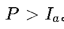 。此时模型的水量平衡为：

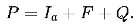

记有效雨量为：

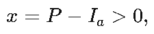

则：

$x=F+Q.$

注意：这里的小写 $x$ 专指有效雨量，不是 Bartlett 论文中可能用来表示相对土壤湿度的 $x$ 。阅读原文时必须重新对照符号表。

如果 $x=30$ mm，那么 $(F,Q)=(20,10)(10,20)(30,0)$ 、 、 都满足守恒。守恒没有选出其中哪一种分配。

**课堂要点：水量平衡是必要条件，但只规定了总和，没有规定分配。**

<!-- 原 PDF 第 2 页 -->

所谓“使模型闭合”，不是把原本不守恒的水量变成守恒，而是补充足够的信息，使输入确定后，未知量也能被确定。

我们最终希望建立的是一条“给定降雨与参数，就能预测径流”的关系。水量守恒尚不足以确定这条关系；

后文先围绕径流函数展开，再说明研究滞蓄函数为什么是等价的选择。

课堂提问： 如果知道一笔钱分给两个人，而且总金额不变，能否仅靠总金额知道各自拿多少？还缺什么？

## 二、先数未知量：输入、参数与输出必须分开

### 2.1 为什么有时说缺一条关系，有时又说缺好几条？

列出的符号数量，不等于当前计算中待求未知量的数量。

一种常用的参数化方式是：

因此计算的角色分工为：

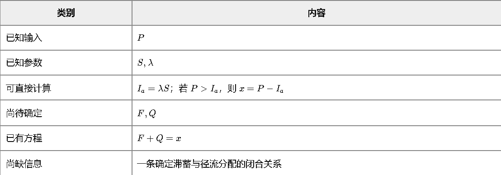

参数在实际研究中可能需要估计；“在一次预测时给定”不等于“我们天然知道其真实数值”。同样，增加一个未知参数，不会凭空补齐信息。

### 2.2 初损尚未满足时，必须分段处理

### 2.3 已知参数在一条曲线上保持固定

后面画 $Q$ 随 $P$ 的曲线，求导或取极限时，均固定 $S,λ$ 及其他背景条件。这是在比较同一组参数下的不同事件输入，不自动等价于沿着一场真实降雨的时间演变。

<!-- 原 PDF 第 3 页 -->

## 三、为什么要无量纲化：把“有多少”变成“相对于什么有多大”

单独知道有效雨量为 30 mm，并不能判断它相对于滞蓄能力是大还是小。

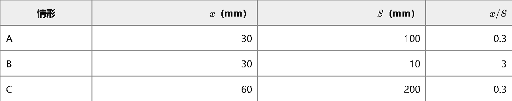

A、B 的绝对雨量相同，但相对雨量相差十倍。A、C 的绝对雨量不同，相对雨量却相同。

这提示我们把雨量与径流都放到同一个尺度 $S$ 上比较。无量纲化的用途不是让公式看起来漂亮，而是提取相对大小，组织不同尺度的结果。

若所选变量足以描述问题，且其他无量纲参数相同，不同 $S$ 下的一族有量纲曲线可能归到同一条无量纲曲线上。若观测明显不能这样归并，就要检查遗漏因素、参数差异或模型结构。

### 3.1 Buckingham π 定理在这里做什么？

定理的要点是：量纲一致、与单位选择相容的关系，如果涉及 $n$ 个量，量纲矩阵秩为 $r$ ，可以用 $n−r$ 个独立无量纲组合表达。在通常的非零、正值情形中最容易说明；涉及零值的边界需要另外检查。

它帮我们确定表达关系的坐标，不能自动决定这些坐标之间的具体函数。相关入门表述见 MIT 讲义。

先把五个量全部列入：

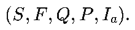

它们都是长度量纲，因此量纲矩阵为：

“独立”表示这些组合的指数向量独立，并不是说四个数在物理上可以随便指定。它们仍然受到守恒约束：

$p=i+f+q.$

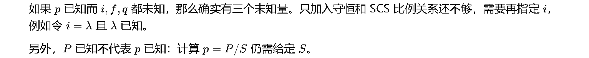

### 3.2 四个无量纲组合，可以表达怎样的关系？

如果五个有量纲量满足某个与单位选择相容的关系 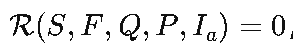 ，π 定理允许用四个无量纲组合改写它：

$H(f,q,p,i)=0.$

- [原文链接 1](https://ocw.mit.edu/courses/2-25-advanced-fluid-mechanics-fall-2013/c0a4521f55e9191d557c167e99e97469_MIT2_25F13_The_Buckingham.pdf)

<!-- 原 PDF 第 4 页 -->

这说明我们不仅找到了四个比值，还可以用它们表达未知关系。但它没有凭空增加方程：如果原关系仅仅是水量平衡，改写后仍然只有 $p=i+f+q$ ，不会自动多出闭合关系。

### 3.3 使用守恒消去滞蓄量，得到未知的径流函数

我们的预测目标是 $Q$ 。这里将 $H(f,q,p,i)=0$ 作为守恒之外、尚待构造的关系的占位表达。在 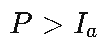 的分支中，已有的质量守恒是：

$f+q=p−i.$

由它直接解出 $f=p−i−q$ ，代入尚未知具体形式的关系：

$H(p−i−q,q,p,i)=0.$

把这个三变量关系记为：

$K(q,p,i)=0.$

这是用守恒消去一个变量，整个步骤只是代数消元。 四个无量纲量的关系因此可以缩减为 $q,p,i$ 三个量的关系。

在我们要建立的确定性预测模型中，把剩余关系视为：给定 $p,i$ 后，可以唯一确定物理上可接受的 $q$ 。于是写成：

**这就是我们想要的结果：先用守恒减少一个变量，再把剩余关系写成以径流为输出的未知函数。 两个输入**

$p,i$ 一般对应一张未知响应曲面，其具体形状留给后续闭合设计确定。

### 3.4 固定初损比例，从未知曲面走到未知曲线

采用已给定的 $i=λ$ ，并令：

定义 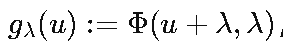 ，于是：

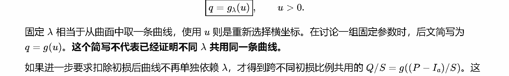

是额外的初损处理假设。

守恒同时给出 $u=f+q$ 。第五个量 $F$ 并没有丢失，而是在 $q$ 确定后由 $f=u−q$ 恢复。

**课堂要点：π 定理整理未知关系的表达结构；单值预测、初损处理和具体闭合形式，仍需要各自的模型假**

**设。**

<!-- 原 PDF 第 5 页 -->

## 四、在找函数之前，先说明为什么把它当成一个函数

第三节已经完成消元，并将剩余关系写为单值径流响应。这里补充说明它的适用条件：更完整地写，应当保留背景条件和形状参数：

$q=g(u;θ).$

其中 $θ$ 包括需要保留的初损比例等参数；讨论一组固定条件时简写为 $q=g(u)$ 。单值函数的存在不是守恒或π 定理自动保证的。

现实径流可能还依赖雨强过程、前期湿度、土壤和地形。总雨量相同，不代表事件响应必然相同。使用单值曲线，意味着这些影响已经固定、用参数概括，或在当前适用范围中被忽略。若残差仍系统地随某个遗漏因素变化，应当重新审查输入选择。

如果目标是条件平均响应，也可以写成：

$E[q∣u,θ]=g(u;θ),$

此时不要求每场事件都落在曲线上。

### 4.1 为什么有时转而构造滞蓄曲线？

**达，不是两条需要分别猜测的独立关系。**

选择哪一侧，只是为了方便思考：径流侧直接对应预测目标；滞蓄侧便于表达“从零逐渐接近有限容量”。

这里先从径流侧构造，之后再用滞蓄增长规律深化解释。

等价要求将函数、约束与参数一起转换。若在两侧分别随意选择不同的函数家族，它们可能已经代表不同模型，不能仅凭守恒就声称等价。对于条件平均响应，若事件逐个满足守恒，也有 $E[f∣u,θ]=u−g(u;θ)$ 。

**课堂过渡语：我们明确了要预测径流，也明确了滞蓄与径流曲线能够互相转换。接下来，把希望模型表现出**

**的行为写成约束。**

## 五、把物理直觉变成约束，而不是马上猜一个公式

我们选择构造一个“有效降雨逐渐填充有限滞蓄空间”的事件模型。对 $u≥0$ ，同一项要求可以在径流侧和滞蓄侧对应表达：

<!-- 原 PDF 第 6 页 -->

长。

这些条件并不全部是守恒的必然推论。例如，守恒可以保证 $Q≤x$ ，却不能推出 $Q/x→0$ 。反例是 $Q=$

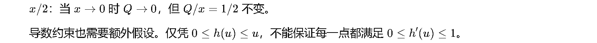

### 5.1 约束之间有些可以互相推出

若 $h(0)=0$ 且 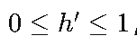 ，那么：

可以在径流侧定义允许的函数集合：

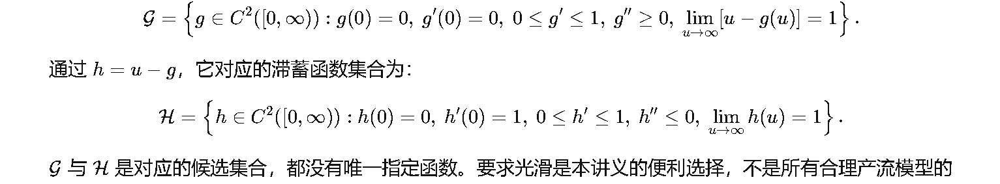

必要条件。

## 六、第一条构造路线：直接构造径流曲线

现在要为第三节留下的未知径流函数 $g$ 选择具体形式。它应从零开始、初始斜率为零，随后逐渐变陡，最终接近直线 $g=u−1$ 。

尝试一个简单的有理函数家族：

**设计，不是 π 定理或边界条件唯一推出来的结果。**

<!-- 原 PDF 第 7 页 -->

### 6.1 用大雨渐近条件确定系数

多项式除法给出：

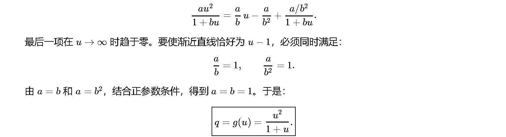

检查其斜率与曲率：

恢复有量纲变量：

对于 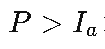 ：

### 6.2 用守恒恢复滞蓄，识别传统比例关系

不是另外猜测 $F$ ，而是直接使用守恒：

与此同时：

所以得到传统比例关系：

若反过来先提出这一比例假设，再结合守恒，则：

<!-- 原 PDF 第 8 页 -->

两条推导方向得到同一个闭合模型。比例假设把实际滞蓄占潜在滞蓄的比例，设为累计径流占有效雨量的比例；两者可能一起增加，并不证明它们必须恰好相等。

### 6.3 反向核对：从滞蓄侧出发也可以

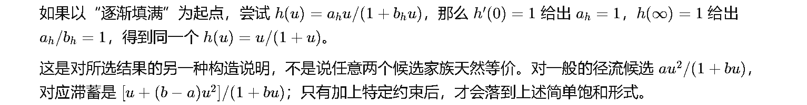

**课堂要点：我们已经得到 SCS，但只是在选定候选家族与约束后确定了它。结果的合理性仍需检验，不能据**

**此宣称它是唯一真实机制。**

## 七、第二条构造路线：先规定新增滞蓄怎样衰减

第六节已经直接构造了径流曲线。现在进一步问：能否先规定一个更容易解释的响应变化规律，再通过积分得到这条曲线？

为表达“剩余容量怎样影响新增滞蓄”，这里转向等价的 $h=u−g$ 。预测目标仍然是径流，最后始终通过

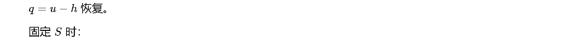

它表示沿这条固定条件的事件响应曲线，增加一点有效雨量，对应增加多少滞蓄。它是对事件总量的导数，不自动等于真实降雨过程中的瞬时入渗比例。

剩余容量比例是 $1−h$ 。我们可以提出候选闭合：

设，不能由 π 定理直接推出。

### 7.1 这个设计怎样保证形状？

在 $0≤h<1$ 的分支上：

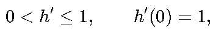

并且：

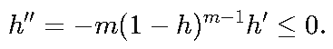

因此，递增、斜率不超过 1、增长逐渐变慢，都由方程结构保证。

### 7.2 当 $m=1$ ：得到指数饱和曲线

使用初值 $h(0)=0$ 积分：

<!-- 原 PDF 第 9 页 -->

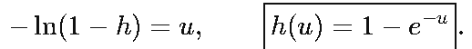

对应的径流为：

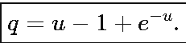

它满足我们选定的形状条件，但不是 SCS 曲线。

### 7.3 当 $m=2$ ：得到 SCS 曲线

从初值积分到 $(u,h(u))$ ：

所以：

为必然选择。

**课堂要点：这条路径把“为什么比例相等”改写成“为什么边际滞蓄比例与剩余容量比例的平方相等”。假**

**设的位置更清楚了，但仍需要依据。**

## 八、得到完整 SCS-CN，并检查它的行为

恢复初损分支，完整事件径流关系为：

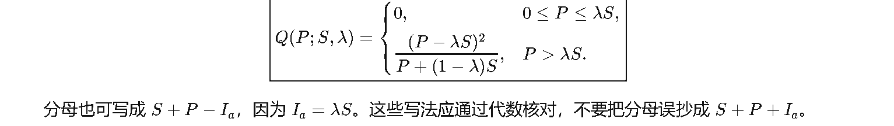

在产流分支：

### 8.1 非负与守恒

对 $x≥0,S>0$ ：

$0≤Q≤x,$ $0≤F<S,F+Q=x.$

<!-- 原 PDF 第 10 页 -->

### 8.2 小雨与大雨

当 $x≪S$ ：

当 $x→∞$ ：

小雨主要被滞蓄，大雨下径流曲线渐近于斜率为 1 的直线。

### 8.3 累计径流比例不等于边际径流比例

而：

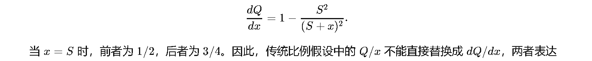

不同的信息。

### 8.4 一个适合板书的数值例子

取 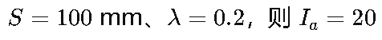 mm、 ，则 mm。这里选择 0.2 只是展示传统参数化的算例，不声称它适用于所有流域。

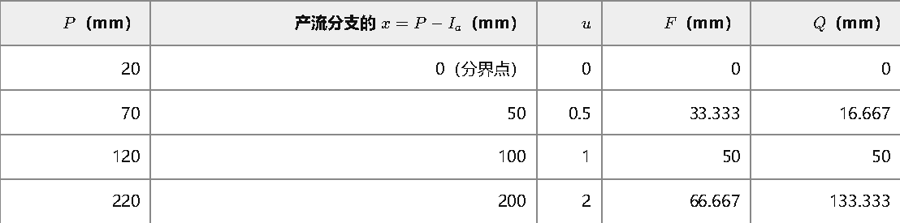

例如第二行， $20+33.333+16.667=70$ 。让学生同时核对总水量、比例关系和初损阈值，比只代入一次公式更有效。

### 8.5 CN 在这条逻辑中出现在哪里？

CN 并不是 π 定理自动给出的闭合关系。它用于把滞蓄参数与工程参数表和流域条件联系起来。 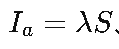 、CN 换算与比例闭合的官方传统表述见 NRCS 2004 年手册第 10 章。初损比例改变后，应重新检查原有 CN标定或查表体系是否仍适用。

- [原文链接 1](https://directives.nrcs.usda.gov/sites/default/files2/1720460920/Chapter%2010%20-%20Estimation%20of%20Direct%20Runoff%20from%20Storm%20Rainfall.pdf)

<!-- 原 PDF 第 11 页 -->

## 九、为什么不能说“由这些要求证明了 SCS 必然正确”？

因为我们已经构造出两个满足要求的函数：

对应小雨径流分别为：

两者都可接受，却给出不同预测。这说明边界与形状条件能够筛选函数，但尚不足以选定唯一形式。

据。

历史上，官方手册将 Mockus 的推导定位为获得合适降雨—径流曲线形状的尝试，而不是由机制唯一演绎出来的结果。本文的两条构造路线用于解释其数学结构，并不改写这一历史性质。NRCS 手册 630.1001(a)

**课堂要点：有合理约束、有清楚参数、符合数据，可以支持模型的使用；它们不等于对唯一真实机制的证**

**明。**

## 十、如何把“经验选择”变成可重复的数学程序？

### 10.1 形状约束回归：先允许一类曲线，再由数据估计

我们已经定义允许集合 $H$ 。如果有同类条件下的降雨—径流数据，就可以在这个集合中估计函数，而不是随意拟合多项式。

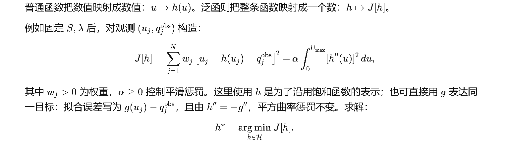

第一项衡量径流预测误差，第二项惩罚过度弯曲。这个目标是估计准则，不自动是自然界的能量或耗散定律。实际可用样条表示函数，把问题转化为受约束的系数优化。单调性、凹凸性约束的回归方法可参考 Pya与 Wood（2015）。

有限区间的观测不能单独验证无穷远极限，尾部条件还需要在函数表示或外推规则中体现。写下最小化符号也不保证最小值一定取得或解唯一；严格分析需要检查函数空间、目标和约束。

### 10.2 参数化比较：先比较少量有意义的候选族

如果目标是得到简洁、可解释的工程公式，可以先比较有理函数、指数饱和函数或 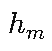 这样的少量候选族。

对第 $j$ 场事件：

- [原文链接 1](https://directives.nrcs.usda.gov/sites/default/files2/1720460920/Chapter%2010%20-%20Estimation%20of%20Direct%20Runoff%20from%20Storm%20Rainfall.pdf)
- [原文链接 2](https://doi.org/10.1007/s11222-013-9448-7)

<!-- 原 PDF 第 12 页 -->

一个可操作的流程是：

1. 明确事件划分、直接径流提取方式和适用的前期状态范围。

2. 选定少量满足约束的函数族，各自估计参数。

3. 检查残差是否随雨量、雨强、前期湿度系统变化。

4. 用未参与估计的事件检验预测，并比较复杂模型的改善是否稳定。

5. 若偏差来自遗漏因素，增加相应输入或状态描述；不要只不断增加曲线自由度。

数据既可估参数，也可比较或否定模型结构。没有“数据只能定参数、不能选形式”的普遍数学禁令。

另外， 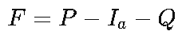 通常是间接计算的。直接比较 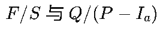 与 会共享观测和参数误差，不构成独立的机制验证。最好结合独立的湿度、蓄水或产流区域信息。

### 10.3 泛函分析、变分法和闭合设计的区别

最大熵也不是自动选定闭合关系的唯一方法。使用最大熵之前，必须先指定随机变量、支持域和约束等信息；这些仍包含建模选择。

## 十一、进阶旁注：π 定理与群有关，但群不能替我们选定 SCS

这一节可在主线讲完后选讲。

对 $Q,x,S$ 同时进行数值缩放：

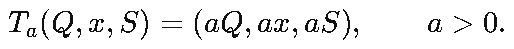

这些变换可复合、可撤销，并有恒等变换，构成正数乘法群。换单位时，这是一组数字表示的变换；在固定单位下改变物理尺度，则还需要检查全部相关物理条件是否相似。

比值满足：

<!-- 原 PDF 第 13 页 -->

所以 π 群是单位缩放作用下的不变量。对正数变量取对数后，缩放变成平移：

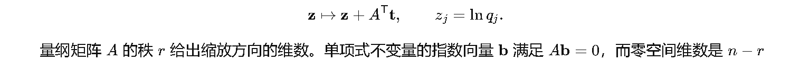

。这将群的语言与线性代数连接起来。证明可参考 Hanche-Olsen 的讲义。

假设 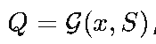 ，与单位缩放相容意味着：

不要把它误说成“有缩放对称性，就只能是单一幂律”。只有在单变量关系满足特定的齐次条件，例如

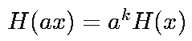 对所有正 $a,x$ 成立时，才直接得到 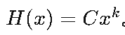 。两个变量共同缩放，可以保留任意的比

值函数。

## 十二、课堂上如何把这条故事讲完整？

可以安排为一次约 90 分钟的教学，也可以拆成两次课。群论与函数空间优化是选讲，先确保核心建模链条清楚。

建议黑板上始终保留以下六行：

标，第五行才选定具体闭合形式。π 定理和守恒没有唯一推出第五行。

### 12.1 随堂练习与答案要点

题 1： 已知 $P=70S=100λ=0.2$ mm、 mm、 ，只用守恒能否求 $Q$ ？

- [原文链接 1](https://hanche.folk.ntnu.no/notes/buckingham/buckingham-a5.pdf)

<!-- 原 PDF 第 14 页 -->

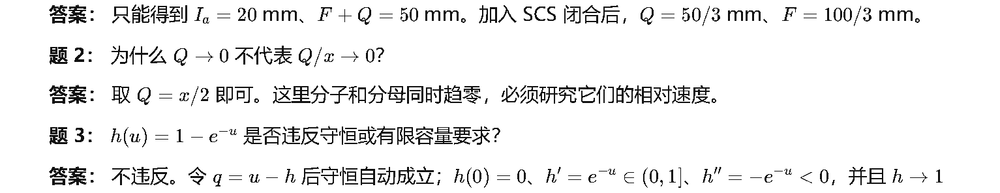

。这反证边界与形状约束尚不能唯一确定 SCS。

答案： 没有。我们证明的是选定微分闭合与 SCS 曲线之间的数学等价性；指数为 2 的物理依据仍待验证。

题 6： 为什么 $q=g(u)f=h(u)$ 与 等价，却不能在两侧各自任意选一个函数家族，就说它们代表同一个模型？

答案： 等价需要满足 $h=u−g$ ，并同时转换约束与参数。分别选择家族可能引入不同的结构假设。只有对应转换，才保持同一水量分配关系。

## 十三、留给下一讲：从“规定平均关系”走向 Bartlett 的空间平均解释

至此我们得到了一条完整但有边界的逻辑链：以预测径流为目标，守恒规定总量，参数化给定当前条件，量纲分析把预测关系整理为未知曲面和固定参数下的未知曲线；径流与滞蓄可以等价转换，形状约束缩小候选范围，额外闭合选择确定 SCS 曲线，增长规律提供另一种解释，而观测继续检验其适用性。

仍然留下一个更深的问题：

我们能否不直接规定流域平均滞蓄与平均径流的关系，而是先描述流域内部不同位置的响应，再通过空间平均得到整体曲线？

这就是衔接 Bartlett 的合适入口。其 ProStor 框架从点尺度产流响应和空间异质性的概率描述出发，构建流域平均响应，并在特定假设下联系到传统 SCS-CN 及其扩展。Bartlett 等（2016）下一讲再展开空间分布与积分。本讲只需把研究问题推进一步：原先的平均尺度闭合假设，能否转化成更可

**解释、可观测、可检验的点尺度机制和空间分布假设？**

**参考资料与使用说明**

本讲义的函数构造、代数整理、反例与教学练习为围绕上述建模问题的推演；不作为任何作者原始论证的逐字转录。引用资料支持定理、传统模型来源与方法背景。

- [原文链接 1](https://doi.org/10.1002/2015WR018439)

<!-- 原 PDF 第 15 页 -->

1. USDA NRCS（2004）. NationalEngineeringHandbook,Part630,Chapter10:Estimationof

DirectRunofffromStormRainfall. 重点读 630.1001(a) 与式 10–6 至 10–12，纸面页码 10–2 至 10–4。官方 PDF。

2. MIT OpenCourseWare（2013）. TheBuckinghamPiTheoreminDimensionalAnalysis, 2.25

Advanced Fluid Mechanics。两页讲义。

3. Hanche-Olsen, H.（2004）. Buckingham’spi-theorem, TMA4195 Mathematical Modelling。

数学证明与量纲矩阵。

4. Pya, N., & Wood, S. N.（2015）. Shape constrained additive models. Statisticsand

Computing, 25, 543–559。DOI。

5. Bartlett, M. S., Parolari, A. J., McDonnell, J. J., & Porporato, A.（2016）. Beyond the SCS-CN

method: A theoretical framework for spatially lumped rainfall-runoff response. WaterResourcesResearch, 52, 4608–4627。DOI；作者所在研究团队提供的 PDF。对应此前讨论的博士论文第 3 章主题。

Markdown 阅读建议：使用支持 LaTeX 数学公式的阅读器。行内公式用 $...$ ，独立公式用 `

$...$

`；不支持数学渲染的预览器会直接显示公式源码。

- [原文链接 1](https://directives.nrcs.usda.gov/sites/default/files2/1720460920/Chapter%2010%20-%20Estimation%20of%20Direct%20Runoff%20from%20Storm%20Rainfall.pdf)
- [原文链接 2](https://ocw.mit.edu/courses/2-25-advanced-fluid-mechanics-fall-2013/c0a4521f55e9191d557c167e99e97469_MIT2_25F13_The_Buckingham.pdf)
- [原文链接 3](https://hanche.folk.ntnu.no/notes/buckingham/buckingham-a5.pdf)
- [原文链接 4](https://doi.org/10.1007/s11222-013-9448-7)
- [原文链接 5](https://doi.org/10.1002/2015WR018439)
- [原文链接 6](https://water.usask.ca/hillslope/documents/pdfs/2016/16-19%20Bartlett_et_al-2016-Water_Resources_Research.pdf)
