<!-- 原 PDF 第 1 页 -->

# 从 SCS-CN 到 SCS-CNx：空间异质性、概率上尺度与完整

**闭式推导**

教师备课讲义，续接《SCS-CN：从水量平衡到闭合关系》。

核心论文：Bartlett, Parolari, McDonnell & Porporato（2016），Beyond the SCS-CN method: Atheoretical framework for spatially lumped rainfall-runoff response，Water Resources Research52, 4608–4627，DOI 10.1002/2015WR018439。

本讲义覆盖正文式 (4)–(30) 的理论主线与附录 A–E；传统式 (1)–(3) 用于衔接前篇。区分概率恒等式、点响应假设、空间分布假设、严格积分结果和数据近似。关键计算已实际通过 Wolfram Kernel 执行，不仅是代码示例。

阅读层次：第一至十节是完整理论主线；十一至十五节处理空间分位数、敏感性、参数和数据解释；最后提供核验结果、课堂安排、练习与原文对应表。

前篇：SCS-CN 闭合关系讲义。积分细节补充：式 (7)、(8) 与 Appendix E 专题。

## 一、从前一讲留下的问题出发

本讲的主线是：先规定一个位置怎样产流，再用概率把不同位置组织起来，最后得到全流域的产流分布与平均降雨—径流曲线。第一至五节搭建机制和一般积分框架；第六至九节代入具体分布，把框架算成 SCS-CNx 的闭式结果；后面的章节解释结果、边界与验证。读到复杂积分时，可以随时回到这条主线，辨认自己正在完成哪一步。

前篇在输入与参数给定后，由水量守恒与闭合选择得到：

小雨分支为 $Q=0$ 。如果初损为零：

我们已经知道，这条曲线可以由比例假设构造，也可由某种滞蓄增长率方程构造，但这些做法没有唯一证明真实流域内部一定按该规则产流。

这一讲换一个问题：

能否先描述每个位置怎样产流、不同位置有什么差别，再对流域做空间平均，得到 SCS 类产流曲线？

如果成功，不仅能预测平均产流，还能回答：

多大面积不产流？

多大面积跨过蓄水阈值？

产流深在流域内怎样分布？

两个流域平均径流相同，内部的产流分布是否仍可能不同？

- [原文链接 1](file:///C:/Users/owen/Documents/OneDrive/Study/%E4%B8%8A%E8%AF%BE/Bartlett_2016_Mathematica/output/pdf/assets/SCS-CN_%E4%BB%8E%E6%B0%B4%E9%87%8F%E5%B9%B3%E8%A1%A1%E5%88%B0%E9%97%AD%E5%90%88%E5%85%B3%E7%B3%BB_%E6%95%99%E5%AD%A6%E8%AE%B2%E4%B9%89.md)
- [原文链接 2](file:///C:/Users/owen/Documents/OneDrive/Study/%E4%B8%8A%E8%AF%BE/Bartlett_2016_Mathematica/output/pdf/assets/Eq7_8_AppendixE/Bartlett_%E5%BC%8F7_8%E4%B8%8EAppendixE_%E5%AE%8C%E6%95%B4%E6%8E%A8%E5%AF%BC.md)

<!-- 原 PDF 第 2 页 -->

这就是 ProStor（probabilistic storage，概率蓄水）框架的目标。SCS-CNx 是该框架在一组具体点响应和概率分布假设下得到的闭式模型；ProStor 本身比 SCS-CNx 更一般。

**课堂过渡语：前篇直接设计平均曲线；这一篇设计局地响应和空间分布，再计算平均曲线。闭合假设没有消**

**失，而是转移到了更细的层次。**

把前篇留下的问题再明确一点：在无初损情形下，水量平衡只给出 $g(u)+h(u)=u$ ，前篇另外选择了

**$h(u)=u/(1+u)$ ，才得到 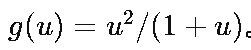 。本篇要追问：这个平均尺度上的闭合函数，能否由一组局地**

**响应与空间分布假设计算出来，而不在平均尺度上直接预先指定？ 第六至九节完成空间平均，第十节将专门**

回到这个问题：先检查能否恢复前篇的函数，再解释预阈值产流如何改变它。

## 二、先重建符号：点值、空间平均与时间平均不能混用

上一节提出了空间差异带来的问题。本节先统一语言：哪些量属于某一个位置，哪些量是整个流域的平均，哪些又是在不同事件之间统计的量。这里不求新结果，而是为后面“逐点响应”和“面积加权”准备记号；

尤其不要把局地容量 $w$ 与平均容量 $wˉ$ 混为一谈。

### 2.1 单次事件中的局地变量

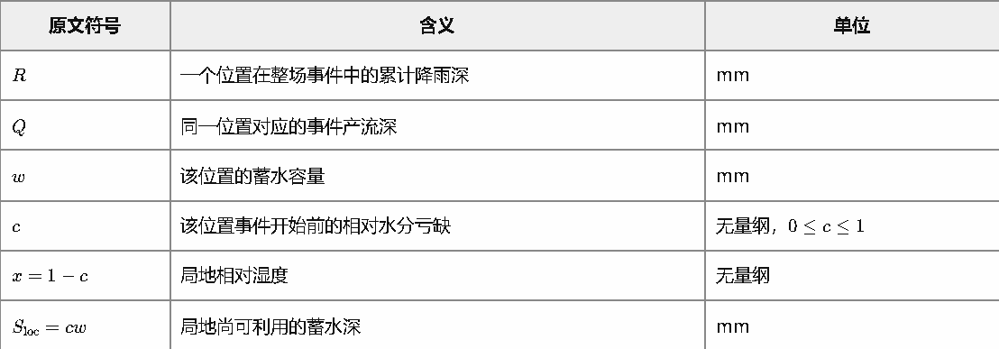

### 2.2 空间平均与一个随机位置

在流域 $Ω$ 内按面积均匀抽一个位置，读取当地 $R,c,w$ 。这些场值便构成随机变量。一次事件中的概率是面积比例，例如：

产流深不超过 $q$ 的面积

$Pr(Q≤q)=$ $.$

流域面积

所以：

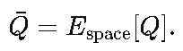

<!-- 原 PDF 第 3 页 -->

这也解释了为什么“每点响应是确定的”和“产流具有概率分布”可以同时成立：每个位置给定输入后输出确定，但不同位置的输入不同。

对于有阈值的非线性响应，先平均输入再计算，一般不等于先逐点计算再平均：

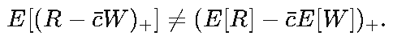

例如平均雨量低于平均剩余容量时，“平均点”可能不产流，但流域内仍可能有雨量较大或容量较小的位置产流。概率上尺度正是要保留这部分平均点模型会遗漏的信息。

### 2.3 后续计算的辅助符号

进入指数分布特例时，本讲义采用：

配套 Wolfram 脚本保留原来的代码变量名，以免改变已核验的程序：mu、om、dd 分别对应 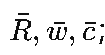 ；

放在后面单独解释。

## 三、用概率组织空间差异：正文式 (4)–(13)

有了点值与平均量的区分，现在要把“各位置不同”写成可计算的形式。本节把面积比例表示为概率，并说明怎样从输入的联合分布得到输出分布。先保留一般的点响应和分布，不急着采用指数假设；下一节再具体规定一个位置如何产流。

### 3.1 联合分布与确定性响应

为避免同一字母既指输出又指函数，本讲义用：

条件概率分解给出原文式 (4)：

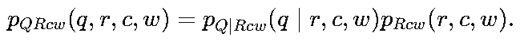

式 (5) 假设给定输入后输出确定，因此式 (6) 是：

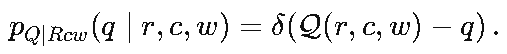

这里是 Dirac 概率测度的广义密度，不是普通的有限函数值。其含义是，在输出轴上全部条件概率集中于

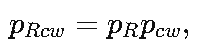

<!-- 原 PDF 第 4 页 -->

就得到式 (7)：

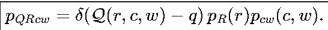

仅有成对独立一般不能保证联合因子分解；实际使用的是 $R⊥(c,w)$ 。此时尚未要求 $c$ 与 $w$ 独立。

### 3.2 边缘化与上尺度

式 (8)：

固定输出 $q$ ，对所有会产生它的输入组合累加概率。对完整输出测度求一阶矩，得到式 (10)：

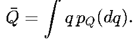

CDF（累积分布函数）表示“产流深不超过某个值的面积比例”：

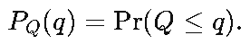

这里第一次遇到“概率原子”，先把它的含义说清楚：某一个精确的数值本身就占有正的概率，而不只是它附近的区间有概率。 例如流域有 100 个等面积格子，其中 40 个完全不产流。在流域中按面积均匀抽一个位置，就有：

**面有时简称“零原子”。“零”指产流量为零，不是概率为零；“原子”也不是物质颗粒，而是集中在一个**

**数值上的概率质量。**

普通连续分布的一个精确值没有正概率，必须累计一个区间才有概率；这里却有 $Pr(Q=0)>0$ 。这并不矛盾，因为产流分布可以同时包含零点的集中概率和正产流区间上的连续概率。

为什么连续的输入雨量也能形成这个集中概率？后面将规定一类位置在蓄水填满前不产流，即整段 $0≤r<$

$τ$ 的雨量都产生同一个输出 $Q=0$ 。不是只有“没有下雨”才产生零径流，而是许多不同的正雨量也被映射

到零；把这些输入对应的面积累计起来，就形成零点的概率质量。

0.4。这个跳跃的高度正是零产流概率原子的大小。

此时若用普通反函数的方式求 20% 分位数，尝试解 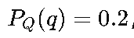 ，会发现没有解，因为 CDF 直接从 0 跳过了 0.2。但按面积排序，最小的 40% 面积都不产流，所以 20% 分位数应当是零。

因此，式 (9) 中的逆 CDF 应理解为“广义逆”：找到最小的产流深，使累计面积比例达到或超过指定水平。

用 $v∈(0,1)$ 表示分位水平，其定义为：

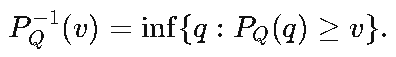

其中 $inf$ 表示下确界，在这里可理解为上述条件首次达到的产流深。在这个例子中，所有 $0<v≤0.4$ 的分位数都为零。这样，即使 CDF 有跳跃，仍能为每个分位水平定义对应的产流深。

<!-- 原 PDF 第 5 页 -->

### 3.3 土壤状态的参数化是另一层闭合

前面的式 (8) 给出了怎样计算产流分布，但要实际做积分，还需要知道被积函数中的输入分布。即使已经指定降雨分布 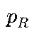 和点响应 $Q$ ，我们仍需要回答：流域内不同的亏缺 $c$ 与容量 $w$ ，各自占多少面积，又怎样组

样分布。因此式 (11) 写为：

接下来出现一个建模困难：容量分布在本文中视为不随事件改变，而前期亏缺分布会随流域变干、变湿而改变。如果每场事件都必须知道完整的空间亏缺分布，模型所需的信息就很多。

为简化状态描述，作者提出：对一个给定流域，先选定一族亏缺分布，用当前的平均亏缺 $cˉ$ 作为控制它的状态参数。也就是说，给定 $cˉ$ ，便按这套规则构造一个近似的空间联合分布。于是式 (12) 写为：

**说知道一个均值，就能数学上唯一确定任意分布，而是额外选择了一套“平均状态如何对应空间分布”的模**

型规则。 这就是另一层闭合假设，并非由守恒自动推出。

所构造的分布首先应满足非负、归一化与取值范围约束。取值范围约束在概率论中也称“支持约束”，意思是概率只能分配给物理允许的取值：例如 $c$ 必须在 $[0,1]w$ 内， 必须在 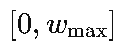 内；后面采用无界指数容量

一般情况下：

$E[cw]=E[c]E[w].$

后面能写 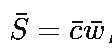 ，是因为采用了更具体的均匀亏缺假设。

## 四、点尺度模型怎样设计：两类区域与共同蓄水阈值

上一节给出了概率统计的容器，但容器里还缺少具体的降雨—径流响应。本节补上机制输入：两类位置在阈值前如何响应、为何采用共同蓄水状态、怎样得到阈值与阈值后的分段公式。这些机制与闭合假设规定好后，下一节才能逐个分支计算其概率贡献。

### 4.1 为什么引入两类区域？

论文把流域划成两类响应区域：

面积比例 $β$ ：达到蓄水阈值前就可以产流，响应记为 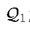 ；

<!-- 原 PDF 第 6 页 -->

面积比例 $1−β$ ：阈值前不产流，响应记为 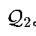 。

$β$ 是具有预阈值响应的类型比例，不是某一场雨结束时已经超过阈值的面积比例。后者记为 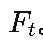 。

两类区域的点响应、共享的输入分布以及固定面积混合权重，是模型结构的一部分。如果区域类型与容量等变量具有不同的条件分布，需要相应修改混合模型。

### 4.2 阈值前先规定响应，再由水量分配得到共同阈值

上一节只规定了两类区域的区别：类型 1 可以在填满之前产流，类型 2 要等填满后才产流。接下来需要进一

**步回答：填满之前各自流出多少水？扣除流出的水后，需要下多少雨才能填满？ 本节就用这两个问题把点响**

应与阈值连接起来。

先只使用原始符号，暂不引入简写。这里比较具有同一组局地输入 $(r,c,w)$ 的两类响应，并不是说整个流域的降雨和容量都一样。先看两类点各自会留下多少水，再引入作者关于侧向交换的设定；到需要计算共同水量收支时，面积比例才进入推导。

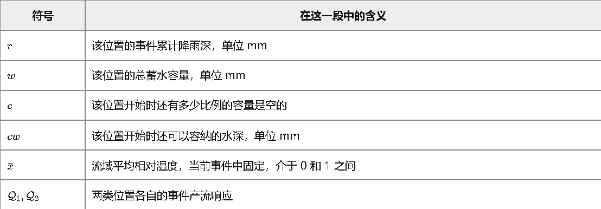

第一步：先规定尚未填满时的产流响应。 这里开始加入点尺度的闭合假设，而不是继续仅由守恒推导。作者的物理动机是：某些区域在剩余蓄水容量尚未填满时，就已有能够将水传输到河道的流动路径；前期越湿，更多孔隙和流动路径被水填充并连通，预阈值产流能力也越强。原文在这一机制说明后引用 Sidle 等（2000）、Kim 等（2005）和 Lin（2012）；这段引用支持的是湿度与水流连通性的机制解释，不能仅据此认定这些文献已经推导出下面的精确线性公式。

可以把作者采用的关系拆成两层来理解。先用一个无量纲径流系数 $k(xˉ)$ 表示类型 1 区域在阈值前有多少比例的当地降雨转为产流：

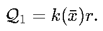

再选择最直接的线性湿度响应 $k(xˉ)=xˉ$ 。类型 2 则按上一节的定义，尚未跨阈值时不产流。因此论文采用：

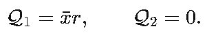

例如，固定前期平均湿度 $xˉ=0.3$ ，且仍处于阈值前，当地下了 20 mm 雨，类型 1 的预测产流就是 $0.3×$

$20=6$ mm；类型 2 为零。在图 2a 中，这对应从原点开始、斜率为 0.3 的黑线，图 2b 的黑线则暂时沿着

横轴。此时 $xˉ$ 是固定参数，并不随横轴雨量一起更新。

**“越湿，提前产流越多”是物理动机；“径流系数恰好等于平均湿度”是进一步的定量简化。 前者并不能唯**

一推出后者。选择 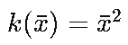 等关系也可能表达相同的变化方向，但会构成不同的点响应模型，阈值和后续空间平均都要重新推导。

<!-- 原 PDF 第 7 页 -->

因此，给学生讲时应明确：我们先接受 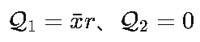 、 这组有物理动机的简化假设，再检查它与水量守恒、侧向再分配和容量阈值一起会产生什么结果。下面的灰线与阈值是这些设定的后果，不能反过来用它们证明第一步必然正确。

第二步：先看没有侧向交换时，两类点会发生什么。 一个已知类型的位置仍然“非此即彼”：类型 1 用 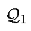，类型 2 用  。如果两类点各自是没有交换的独立桶，阈值前分别留下：

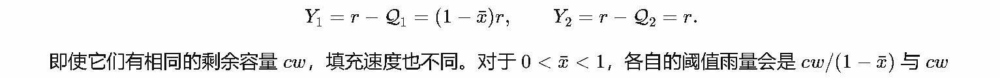

，并不能从守恒直接得到共同阈值。

**第三步：作者选择考虑侧向交换，并进一步假设共同蓄水状态。 上面的蓄水差异使我们有理由追问：如果两**

类区域存在水力连接，侧向交换会怎样改变它们的填充？论文用侧向水分再分配来描述这种影响，并采用一个简化闭合：对所比较的同一组局地输入，两类点具有相同的有效蓄水增量。先把这个尚不知道数值的共同水深记为 $Y$ ：

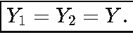

这里要明确区分：“可能发生侧向交换”不等于“必然达到相同状态”。两类点共享 $Y$ 是作者采用的有效状

**态假设，需要单独接受；它既不是蓄水差异的必然结果，也不是为了画出共同折点而由数学强制要求的。 下**

面要回答的是：接受这一假设后，共同水深 $Y$ 应当是多少？

**第四步：用参与交换的两类区域的总水量守恒，求出 Y；面积比例在这里自然出现。 用一个理想化的代表单**

元说明收支，设其中两类区域的面积分别为 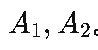 。两类区域接受相同的给定雨深 $r$ ，最终具有相同的蓄水增量 $Y$ ；内部侧向交换在整个单元的收支中相互抵消。将水深与面积使用一致单位，总水量守恒写为：

降雨总水量 产流总水量 共同蓄水对应的总水量

除以总面积，得到：

使用前一节定义的类型比例，便有：

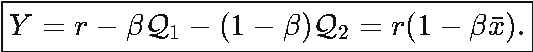

**这样， $β$ 的作用来自一个具体问题：要算共同剩下多少水，必须知道两类区域各有多大，才能把各自的产流**

深换算成总流出水量。 类型 1 点自己的产流仍然是 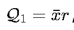 ，并没有变成 $βxˉr$ 。

这个代表单元用于解释论文的闭合收支，不是原文已解析得到的真实邻接格局。它采用同一组输入下的类型混合与共同状态；实际区域怎样连接、局部面积构成是否等于流域比例，仍属于模型所简化的空间信息。这

位自身面积得到 6 mm 补充，让类型 2 每单位自身面积向外转移 4 mm；按面积加权，两边的交换量都是

$0.4×6=0.6×4=2.4$ mm。这里类型 2 的侧向转移是输给另一类位置的水，并不等于它向河道产生了 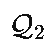

。

<!-- 原 PDF 第 8 页 -->

教师备课时可以进一步用收支反推出该闭合隐含的等效交换。令 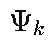 为每类点每单位自身面积的净侧向入水深，正号表示入水，负号表示出水：

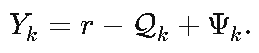

要实现上述共同蓄水状态，必须有：

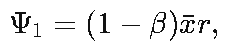 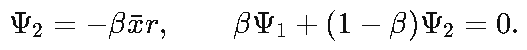

这说明共同状态在代数上可以与加权水量守恒相容，但并没有证明真实流域一定能实现这种交换。以上是对闭合含义的收支重构；原文此处并未求解具体的侧向交换速率、空间连接方式或均衡时间。不能把这项假设讲成已经从概率公式推导出的物理必然性。

第五步：用共同蓄水深求共同阈值。 现在已经求得 $Y=r(1−βxˉ)$ 。当它达到局地剩余容量 $cw$ 时，就跨过阈值：

$r(1−βxˉ)=cw$ $.$

有效蓄水增量 开始时的剩余容量

把满足此条件的降雨深记为 $τ(c,w)$ ，解得：

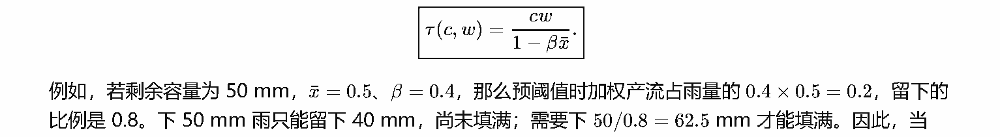

$βxˉ>0cw>0$ 且 时，阈值雨量比剩余容量更大：填充过程中已经有一部分雨量流出。

最后再对应到前面定义的简写，方便后续代数：

$ι=βxˉ,a=1−βxˉ.$

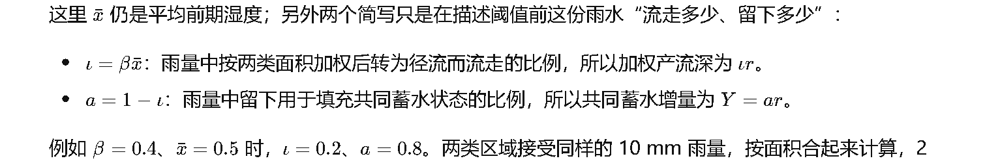

mm 转为径流，8 mm 留下用于填充。它们不是两个独立参数，也不是两类区域的面积比例，而是同一份雨量分配的互补比例，满足 $ι+a=1$ 。

续看到 $ιa$ 、 时，可以分别读成“流走的比例”和“留下填充的比例”，但这一解释只针对上述阈值前构造。

**本节的讲课顺序应当是：先指定点响应 → 发现无交换时两类点的填充不同 → 明确作者采用的侧向交换与共**

**同状态假设 → 用两类区域的总水量守恒引出面积比例 → 求共同阈值。 “为什么要引入面积比例”由共同收**

支的问题回答；“为什么两类点具有共同状态”仍然是一项明确的闭合假设。这是便于教学的逻辑重建，不声称是作者提出模型时的历史思考顺序。

### 4.3 跨阈值后如何写响应？

阈值以上，假设点响应相对于降雨的斜率为 1，并保持分段点连续。

类型 1 在阈值处的产流为 $xˉτ$ ，故：

<!-- 原 PDF 第 9 页 -->

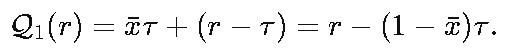

类型 2 在阈值处产流为零，故：

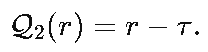

这便得到原文式 (14)、(15)：

在 $r=τ$ 处，两条曲线各自连续。对应核验见 Wolfram 验证脚本 中的 Q1Continuity 与Q2ThresholdValue：前者检查类型 1 两段在阈值处相等，后者检查类型 2 的阈值后分支在该处等于阈值前的零值。也可打开配套 Mathematica Notebook，并配合 式 (7)、(8) 与 Appendix E 推导教程 阅读；脚本中的 xb 对应本讲义的 $xˉ$ 。

### 4.4 先核对加权水量守恒

令 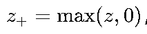 ，两类点的加权产流可写成：

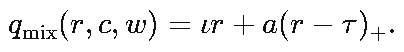

所以：

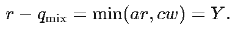

这是之后直接求平均径流的一条捷径。

但是， 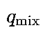 只是固定 $(r,c,w)$ 下的类型平均。求完整 PDF 时必须保留：

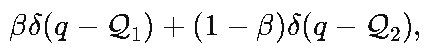

不能替换成 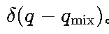 。例如一半区域产流 0、一半产流 6，其均值为 3，但其分布不是全部集中在 3。

## 五、从一个位置产流多少，到不同产流量各占多少面积

第四节已经给出点响应：知道一个位置的雨量、亏缺、容量和类型，就能算出产流。但本讲最初的目标是得到整个流域的降雨—径流响应，因此还要把不同位置产生的水量汇总起来。各位置产流不同，要计算总径流或平均径流，既要知道“产流有多深”，也要知道“这样的产流覆盖多少面积”：每类位置的产流深乘以其面积，再把各类水量相加，才能得到全流域总量。

这便引出了一个有用的中间问题：“产流落在某个范围内的位置，占全流域多少面积？” 例如，知道有一半面积产流 2 mm、另一半产流 18 mm，就能算出平均产流为 10 mm，还能看出大部分径流来自高产流的那一半。若所有位置都产流 10 mm，平均值也相同，但空间产流组成不同。作者希望同时得到平均曲线和这种空间差异，所以先统计不同产流量所占的面积，也就是建立产流分布。

如果只有求平均值这一项任务，也可以直接对点响应作面积加权；本节采用分布路线，是为了在汇总平均径流的同时保留不产流面积、产流强弱与不同响应来源的信息。接下来先从数位置理解这项统计，再把它写成概率积分。

- [原文链接 1](file:///C:/Users/owen/Documents/OneDrive/Study/%E4%B8%8A%E8%AF%BE/Bartlett_2016_Mathematica/output/pdf/assets/Eq7_8_AppendixE/Bartlett_Eq7_8_AppendixE_Verify.wl)
- [原文链接 2](file:///C:/Users/owen/Documents/OneDrive/Study/%E4%B8%8A%E8%AF%BE/Bartlett_2016_Mathematica/output/pdf/assets/Eq7_8_AppendixE/Bartlett_Eq7_8_AppendixE.nb)
- [原文链接 3](file:///C:/Users/owen/Documents/OneDrive/Study/%E4%B8%8A%E8%AF%BE/Bartlett_2016_Mathematica/output/pdf/assets/Eq7_8_AppendixE/Bartlett_%E5%BC%8F7_8%E4%B8%8EAppendixE_%E5%AE%8C%E6%95%B4%E6%8E%A8%E5%AF%BC.md)

<!-- 原 PDF 第 10 页 -->

假设流域分成 1000 个等面积格子，逐格计算产流后，有 200 格产流在 5–10 mm 之间，那么相应面积比例就是 20%。在流域按面积均匀抽一个位置，抽到这 200 格的概率也是 20%。因此这里的概率来源于面积抽样；一场已发生事件中，各位置的输入和产流完全可以先看作确定的。

如果掌握每格输入，逐格计算再统计就能完成这件事。现在希望用输入分布得到可计算的表达，需要将雨量、亏缺、容量同时变化的情况分步处理。一种方便的起点是先把状态相同或接近的位置放在一组：固定

$c,w$ 后，门槛 $τ=cw/a$ 就确定了，可以先研究这一组接受不同雨量时会产生什么输出，随后再合并不同状

态组。这里选择先处理雨量，是因为门槛固定后，各分支对雨量的响应是简单的线性关系；这是一条便于计算的路线，并非唯一分组方法。

固定状态后，点响应只是告诉我们雨量与产流怎样对应，还没有告诉我们组内有多少位置接受各类雨量。要继续统计，就需要组内的雨量分布，一般写成 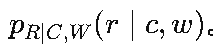 。沿用模型已有的雨量与状态独立假设，它简化为：

变，则应保留条件密度来完成同样的统计。

接下来选定一个要统计的产流范围。手里已有雨量分布，还没有产流分布，可以借点响应把这个输出范围换

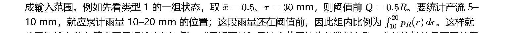

从已知输入分布算出了目标输出的比例。“反解雨量”是这个范围转换的数学名称；此处比较的是不同位置的输入与输出，移动刻度是统计操作。

完成组内计算以后，还要将它放回全流域。例如一组占全流域 10%，其中 30% 满足目标产流，则它贡献全流域的 $0.1×0.3=3%$ 。将各组这样换算后相加，便恢复全流域的面积统计。亏缺、容量连续变化时，组的份额由联合分布表示：在很窄的区间内近似为 $p(c,w)ΔcΔw$ 。这个权重描述有多少位置属于该状态范围，位置可以散布在流域各处。分组计数由此过渡到连续积分。

把刚才对一个分支的做法推广到全部点响应时，还会发现同一目标产流有多个来源：类型 1 阈值前、类型 1阈值后、类型 2 阈值后，对应的雨量范围各不相同。因此逐段寻找有效输入、累计贡献，再按类型比例组合；类型 2 阈值前的整段雨量都产生零，则将这部分单独累计为零点质量。模型采用两类共用输入分布的固定混合设定，所以类型权重可以取 $β1−β$ 、 。对固定类型的位置，我们统计它所属分支的整场产流；组合时要避免重复计入同一份面积。

把这套计数逻辑具体写成公式，可以从类型 1 的预阈值贡献开始。用 $K$ 表示位置的响应类型，先明确要统计的那批位置：

$Pr(K=1,R<τ(C,W),q≤Q<q+Δq).$

它表示“属于类型 1、尚未跨阈值，并且产流落在这个小区间”的全流域面积比例。我们将这一类位置在正

这里 $B$ 是为这份统计贡献取的名称，尚未给出它的计算公式，也不要求它单独积分为 1。接着用全概率公式，将右边按类型 1 内部的状态组拆开：

<!-- 原 PDF 第 11 页 -->

这仍是同一批位置的计数：先取类型 1 的总面积比例，再对各状态组的份额乘组内达标比例并相加。此处尚

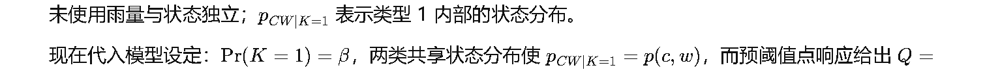

$xˉR$ 。于是：

左边按输出区间累计面积，右边按输入状态分组累计同一份面积，所以二者相等。要实际计算右边的组内概率，就将产流区间反解为雨量区间，再用模型中的共同降雨密度 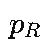 积分；5.1、5.2 会逐步完成这一计算。

最后，在 $B$ 连续的正产流位置，小区间内有：

度。类型 1 阈值后、类型 2 阈值后的贡献也按同一逻辑定义与计算；零产流则单独累计集中质量。

**上述过程可以按固定状态组 → 找各分支的有效雨量范围 → 算组内概率 → 乘状态组份额与类型权重 → 汇总**

各组执行。雨量独立、类型共享输入分布是模型假设；分组加权本身则是全概率公式，不要求这些独立性。

下面不再重复这套统计思路，而按任务计算：

### 5.1 找有效输入：逐段求降雨反解，检查分支，计算输入与输出区间的宽度换算。

### 5.2 汇总贡献：把这些结果写入状态积分，得到三份连续密度与零产流质量。

### 5.3 解释区域差异：全流域分布已得到，再按区域整理条件分布，以分析预阈值机制的贡献。

本节对应原文式 (16)–(21) 与 Appendix E，保留一般输入分布。第六节才指定具体分布，后面再求闭式。

以上是教学上的逻辑重建，不代表作者真实的发现顺序。作者的概率积分路线与逐网格统计、按输入分布抽样，都在计算相同的输出分布；所选响应与分布便于积分时才有简洁闭式。

### 5.1 用一个算例找出有效的降雨来源

下面两小节共用一个教学算例：雨量服从均值为 30 mm 的指数分布，容量固定为 100 mm，亏缺在 0–1 间

子用于展示一般框架，不是第六节采用的均匀亏缺、指数容量特例。

先固定一个亏缺组 $c$ ，其阈值为：

**类型 1，阈值前：**

$q=xˉr=0.5r⟹10=0.5r⟹r=20mm.$

<!-- 原 PDF 第 12 页 -->

**类型 1，阈值后：**

**类型 2，阈值后：**

零产流统计。

移项只是给出候选雨量，还需代回各分支原来的范围：阈值前要求 $r<125c$ ，阈值后要求 $r≥125c$ 。反解及检查结果汇总如下：

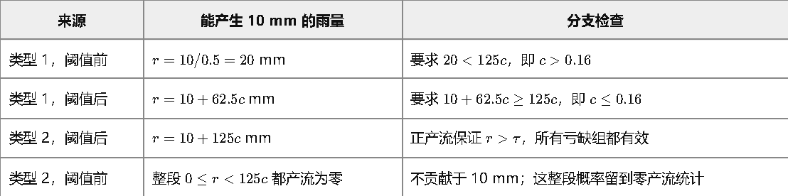

例如类型 1 在 $c=0.3$ 时，20 mm 雨量仍在阈值前，可以通过第一行产生 10 mm；在 $c=0.1$ 时，20 mm已越过阈值，第一行失效，但第二行给出 16.25 mm 的有效雨量。这里只是从不同来源寻找同一个输出，没有将同一位置的整场产流重复分账。

找到对应雨量范围后，先算这段雨量对应的面积比例，再除以产流区间宽度，才得到该区间的平均产流密度。由于雨量与产流的区间宽度可能不同，密度需要按两者的宽度比换算。例如第一行 $q=0.5r$ ，10–10.1mm 的产流对应 20–20.2 mm 的雨量；两段对应同一批位置、概率相同，但雨量区间宽度为 0.2 mm，产流区间宽度为 0.1 mm，因此平均产流密度约为  。区间趋于零时，这个换算给出目标值处的密度。后两行的响应斜率为 1，两种区间宽度相同，换算因子为 1。这就是后面公式中 $1/xˉ$ 的来源。

现在已确定各来源的雨量、有效亏缺范围与宽度因子。完整移项、delta 表达、边界处理以及 Wolfram 核验，见 一般推导附件第三节至第六节；该附件用同一算例把下面的四种情形全部算完。

### 5.2 用同一算例累计面积，再回到一般表达

分得到：

因此下面积分中的亏缺密度可以直接写成 1；这来自本算例的均匀分布假设。各来源按 5.1 给出的范围汇总。以下连续表达描述 10 mm 附近每单位产流宽度的概率贡献，而不是“恰好 10 mm”的概率：

- [原文链接 1](file:///C:/Users/owen/Documents/OneDrive/Study/%E4%B8%8A%E8%AF%BE/Bartlett_2016_Mathematica/output/pdf/assets/Eq7_8_AppendixE/B_T1_T2_%E5%AE%8C%E6%95%B4%E6%8E%A8%E5%AF%BC%E4%B8%8EWolfram%E6%95%99%E7%A8%8B.md)

<!-- 原 PDF 第 13 页 -->

后两种来源则不同：虽然目标产流同样是 10 mm，但不同亏缺组需要的雨量不同。以类型 2 的阈值分支为例，反解为 $r=10+125c$ ：

亏缺较大的位置需要先用更多雨量填充，才产生同样的 10 mm 径流。因此，要先为每组算出对应雨量，再

一行那样提出一个对所有组都相同的密度值。

零产流则不只对应一个雨量：类型 2 在每个亏缺组内的全部阈值前雨量都映到零。于是零产流面积为：

上式已经可以直接算出零产流面积。继续看其中的状态划分：每组雨量要么低于阈值，要么达到或超过阈值，两部分合起来覆盖该组。前面累计了阈值以下的雨量，现在把同一组的雨量积分改为从阈值到无穷大，就能统计组内有多少位置跨过门槛；再对全部亏缺组汇总，得到全流域跨阈值面积比例。将它记为  ：

；乘类型 2 的面积比例 0.6，就可将刚才的零产流表达简写为  。

 因此是从已有阈值判别直接得到的区域面积统计，既用于这里的零质量，也用于下面四类位置的面积份额

和 5.3 的区域条件分布。现在先写出一般表达，第七节再针对论文采用的具体分布计算闭式。一般推导附件

### 7.2 完整展示从阈值事件到概率积分，再到本算例两步积分的过程；附件第四至六节推导各分支，第九节处

理零质量，第十一节完成数值和均值核验。

回到一般容量与亏缺分布，各状态组的份额由联合分布描述；在普通密度情形下写为 $p(c,w)dcdw$ 。将算例中的 $c$ 积分改为对全部状态组合加权，并使用一般反解与分支范围，就得到：

- [原文链接 1](file:///C:/Users/owen/Documents/OneDrive/Study/%E4%B8%8A%E8%AF%BE/Bartlett_2016_Mathematica/output/pdf/assets/Eq7_8_AppendixE/B_T1_T2_%E5%AE%8C%E6%95%B4%E6%8E%A8%E5%AF%BC%E4%B8%8EWolfram%E6%95%99%E7%A8%8B.md#72-%E4%BB%8E%E9%98%88%E5%80%BC%E4%BA%8B%E4%BB%B6%E5%AE%8C%E6%95%B4%E6%8E%A8%E5%AF%BC-f_t)

<!-- 原 PDF 第 14 页 -->

零。固定容量或亏缺的特例，则按其集中概率处理。

将刚才的跨阈值面积统计也推广到一般 $c,w$ 分布：先在固定状态组内累计门槛以上的降雨概率，再乘该组面积份额并汇总，得到原文式 (17)。零产流质量仍由未跨阈值面积乘类型 2 比例得到：

内层统计组内跨阈值比例，外层按各状态组面积合并；这一步用到降雨与状态独立。零质量的乘法进一步用到类型共享输入分布： $Pr($ 类型 $2$ 且未跨阈值 $)=Pr($ 类型 $2)Pr($ 未跨阈值 $∣$ 类型 $2)$ 。

每份质量都是类型比例乘相应状态比例；对该连续分量的全部产流值积分，就收回这一类的全部面积。  是零产流面积的大小， $δ(q)$ 将它放在输出零点。四份相加，完整分布为：

这些表达沿用 $0<xˉ<1$ 、无额外零雨量质量或阈值边界质量的情形。阈值分支的输出是相应位置整场事件的产流。5.1、5.2 到这里完成主线计算；需要每个式子的细节、其他边界或亲手执行积分时，转读附件。

### 5.3 分别看两类区域内部：把已有分布重新组织

到 5.2 为止，全流域产流分布已经写完整了。 四份贡献相加就得到  ，直接对它求期望也能得到全流域平均径流。因此本小节不是补上一个缺失条件，也不是说不做条件化就无法完成计算。

**为什么还值得把结果分区分析？因为本模型新增的是“尚未填满也能产流”的机制，我们希望知道它到底在**

哪些降雨情景下重要、怎样改变总径流。 只知道总平均产流为 10 mm，还不能区分它主要来自少量跨阈值位置的强产流，还是尚未跨阈值区域已经贡献了相当多的径流。把总曲线按区域拆开，才能说明新增机制在模型中怎样起作用，而不只是给出一条不同的曲线。

因此接下来比较两个区域对全流域的贡献  与 。原文图 6 用这种分解分析小雨时预阈值贡献的重要性，以及大雨时阈值产流逐渐占主要贡献；图 7 再展示区域内部产流深的差异。这里是在解释模型预测的组成，不是说这些机制份额已经得到实测空间数据的直接验证；阈值区域的贡献也包含这些位置整场事件的产流，而不只是跨阈值之后新增的部分。

<!-- 原 PDF 第 15 页 -->

就把各组的面积作为新的分母。这才引出下面除以面积比例的操作。

条件 PDF 是作者统一表达区域分布、均值和分位数的一种方式，并不是分析贡献的唯一方法：直接对 5.2 各分量求一阶矩，也能算出相应区域贡献。若课堂只关注总平均曲线及其与传统闭合的联系，本小节可以简讲；若要进一步说明预阈值机制如何塑造这条曲线，则沿下面的区域内部统计展开。先用面积例子解释分母

**怎样改变，再写条件概率公式。改变的是统计的参照范围，不是产流机制，也不会产生新的分布信息。**

**第一步：区分两个不同的问题。**

在全流域按面积均匀抽一个位置，我们可以问：

这个位置既属于预阈值区域，产流又落在某个范围内，概率是多少？

已经知道这个位置属于预阈值区域，在这个区域内部，它的产流落在同一范围内，概率是多少？

第一个问题的分母是全流域面积；第二个问题的分母是预阈值区域面积。因此两者通常不是同一个数。

例如，把流域分成 100 个等面积格子，其中 70 个尚未跨阈值、30 个已经跨阈值。假设前面 70 个中有 35个产流不超过 10 mm：

但只在尚未跨阈值的格子里抽样时：

这就是“除以区域比例”的直觉：把原来相对于全流域的份额，换算成相对于该区域自身的份额。

**第二步：用条件概率把这个换算写下来。**

上一节的  正是“尚未跨阈值且具有相应产流”的全流域分布贡献。它包含类型 2 的零产流原子，以及类型 1 的预阈值连续产流。两者的总概率质量为：

同理，  覆盖已经跨阈值的两类位置，其全流域概率质量为：

<!-- 原 PDF 第 16 页 -->

改为只在阈值区域内部抽样，便得到：

所以，这两个除法不是为了凑出式 (18)，而是为了使各区域内部的条件分布总概率为 1。这里  、 分别

**表示从对应区域抽到的位置的整场事件产流，不是把同一个位置的产流按阈值前、阈值后两个时间阶段拆**

**开。**

**第三步：要回到全流域，就把面积比例乘回来。**

全流域任意一个位置，要么属于 $A$ ，要么属于  。因此，某个产流范围的全流域概率，是两个区域贡献之和：

这就是全概率公式，对应论文式 (18)：

把两个条件分布代回去，除法与乘法正好抵消：

**因此两种表达描述的是同一个分布。可以记成：除以面积比例，是转到区域内部统计；乘以面积比例，是转**

**回该区域对全流域的贡献。**

如果只想求全流域 PDF，直接将四份贡献相加即可，不必先除再乘。论文引入条件分布，是为了能分别讨论两种区域内部的产流分布、平均值等，再把它们组合起来；不是说不做这一步就无法计算。

把 $c>κ$ 写成积分下限，得到式 (19)。把  的 写为“全域减去 $c>κ$ ”，得到式 (20) 的两个类型 1项；减号是域扣除，不代表负概率。

**第四步：平均产流也遵循同样的面积加权。**

分别在两个区域内部求平均，得到  、 ；再按区域面积比例加权，就是全流域平均产流。这是全期望公式，对应式 (21)：

例如两个区域各自平均产流为 5 mm、20 mm，面积比例为 0.7、0.3，则全流域平均为 $0.7×5+0.3×$

$20=9.5$ mm，而不是直接将两个区域均值相加。

边界提醒：上述两个条件分布同时定义时，需要  。如果某一区域面积比例为零，就不能对它除以零或定义该区域的条件分布；此时直接使用存在的区域贡献计算全流域分布即可。

## 六、ProStor 到 SCS-CNx：现在加入具体空间分布

上一节已经列出完整分布的四份贡献  、 、 、 ，但其中仍含一般分布下的积分。为了真正算出公式，本节指定降雨、容量分布与前期状态。这是从一般框架走向具体 SCS-CNx 模型的步骤，而不是重新建立产流机制。

前面仍是一般概率框架。为了算出简洁闭式，论文式 (22)、(23) 进一步规定：

<!-- 原 PDF 第 17 页 -->

这三条分别表示：

**这里的 $c=cˉ$ 是作者在从一般 ProStor 框架具体化为 SCS-CNx 时加入的空间状态假设。 前面的框架允许**

不同位置具有不同的亏缺 $c$ ；现在为了推导这一组闭式结果，假定当前事件开始时，各位置的相对亏缺都等于流域平均亏缺。它不是由水量守恒或概率积分自动推出的，也不是所有流域都必须满足的事实。式中的

$δ(c−cˉ)$ 就是在数学上表达： $C$ 的全部概率集中在 $cˉ$ ，不再保留亏缺比例的空间差异。

备课时要区分名称：这里说的是 Bartlett 对 SCS-CNx 的具体分布假设，不能直接说成“传统 SCS-CN 原本就明确假设每个位置都有相同亏缺比例”。传统 SCS-CN 的集中式公式本身没有显式给出局地 $C,W$ 的联合空间分布；这里是作者为得到 SCS-CNx、并在无预阈值产流极限下恢复无初损 SCS-CN 曲线所采用的空间概率构造。

“比例相同”仍不等于“剩余容量深相同”：例如两个位置的总容量分别为 100 mm、300 mm，都空着20%，则剩余容量分别为 20 mm、60 mm。因此，尽管 $c=cˉcw=cˉw$ 固定， 仍随 $w$ 变化，模型仍保留了容量的空间异质性。

在这个假设下， $cˉ$ 是常数，可以从期望中提出：

记  、 ，便得到：

注意  在这个特例中要换为 $∞$ ；若仍保留有限上限又使用未截断指数 PDF，归一化就不成立。

论文用最大熵讨论指数容量分布的选择。它可以在“非负支持、给定均值”等约束下得到解释，但最大熵并不能自动证明真实容量必然指数分布，也不能自动证明降雨—容量独立。这些都要与适用流域和事件尺度相匹配。

关于为什么选择最大熵、拉格朗日乘子怎样作用于整条密度曲线、为何得到指数形式，以及如何证明是全局最大，见配套 最大熵到指数分布：物理直觉与 Wolfram 逐步教程。该教程配有可直接运行的 Notebook 和核验脚本，不在这里展开泛函推导。

**这是本模型获得闭式的主要代价：空间结构更丰富了，但为了可解性仍采用了很具体的统计假设。**

## 七、阈值面积 F_t 的推导：正文式 (24)

具体分布已经给定，接下来逐项计算。先求最容易辨认的一项：有多少面积跨过当地阈值？这就是  。它还会确定预阈值面积  和零产流质量  ，为后面各区域的条件分布提供权重；但它本身不是平均径流，也不说明正产流具体有多大。

先固定当地容量 $w$ ，此时阈值 $τ=cˉw/a$ 就是一个确定的雨深。我们要问的不是“某个雨量处的密度多高”，而是“雨量足以跨过这个阈值的概率有多大”。

- [原文链接 1](file:///C:/Users/owen/Documents/OneDrive/Study/%E4%B8%8A%E8%AF%BE/Bartlett_2016_Mathematica/output/pdf/assets/%E6%9C%80%E5%A4%A7%E7%86%B5_Wolfram%E6%95%99%E7%A8%8B/%E6%9C%80%E5%A4%A7%E7%86%B5%E5%88%B0%E6%8C%87%E6%95%B0%E5%88%86%E5%B8%83_%E7%9B%B4%E8%A7%89%E4%B8%8E%E9%80%90%E6%AD%A5%E6%8E%A8%E5%AF%BC.md)

<!-- 原 PDF 第 18 页 -->

这里要区分概率密度和超过阈值的概率。前面给出的降雨密度为：

密度是曲线的高度，不是概率本身；若雨深以 mm 表示，密度的单位就是 $1/mm$ 。区间概率则是曲线在相应区间下面的面积，没有单位。

代入指数密度与阈值，得到：

降雨分布。

例如  mm、 mm 时，  是密度高度，而 是阈值右侧整片面积。

上面只计算了给定容量 $w$ 时的跨阈值概率。全流域还有不同容量的位置，怎样把这些条件概率汇总成总阈值面积比例？

先看容量只有两种的情形。 假设 40% 的面积具有容量  ，其中跨阈值的比例为 0.6；另外 60% 的面积具有容量  ，其中跨阈值的比例为 0.2。则全流域跨阈值的面积比例为：

逻辑是“每类位置在全流域所占的面积比例，乘以该类内部跨阈值的比例，再把各类贡献相加”。这与前面按类型面积比例 $β1−β$ 、 加权的思想相同，但这里按容量分组。

容量连续变化时，把分组改成很窄的容量区间。 容量落在 $[w,w+Δw)$ 的位置，占全流域的面积比例约为

 。在这个窄区间内，用容量 $w$ 处的条件概率近似该组跨阈值的比例。因此该组对全流域阈值面积

的贡献约为：

该容量区间的面积比例 该类内部跨阈值的比例

对所有容量区间求和，并让区间宽度趋于零，便得到连续形式的全概率公式：

接用普通概率相除。

再代入上一段得到的跨阈值概率，以及容量的指数密度  ：

<!-- 原 PDF 第 19 页 -->

因此，前一个因子  回答“这种容量的位置中，有多少比例跨阈值”；后一个因子  则表示“这个微小容量区间的位置，在全流域中占多少比例”。两者相乘再积分，就是对所有容量位置的面积贡献进行汇总，不是新增一条产流机制假设。两者也不是无关的概率随意相乘：前一项明确是在同一个容量 $w$ 下计算的条件概率。

合并指数：

使用  ，得到：

这就是式 (24)。

相应地，尚未跨阈值的面积比例为：

**为什么现在就能求出全流域产流面积，而不必先算完整 PDF？ 因为这里只问产流是否大于零，不问它具体**

是多少；点尺度响应已经告诉我们哪些位置会产流，  则告诉我们跨阈值的位置占多少面积。

把正产流位置分成两个互不重叠的来源：

1. 已经跨阈值的位置：面积比例为  。当 时，两类响应都大于零，因此这一部分全部贡献正产流面

积。类型 2 在恰好 $r=τ$ 时仍为零，但本特例采用连续、独立的降雨与容量分布，恰好相等的概率为零，不影响面积比例。

在尚未跨阈值的区域内仍可以用 $β$ 作为类型 1 的比例。如果类型与降雨、容量或亏缺有关联，使区域内部的类型比例改变，就不能无条件使用这个乘积。

把两份不重叠的面积贡献相加，便得到：

也可以从“不产流的位置”反推：在上述非退化条件下，只有尚未跨阈值的类型 2 位置不产流，其面积比例

失，不能再按上述理由增加  ，应直接回到点尺度响应重新判断。

<!-- 原 PDF 第 20 页 -->

## 八、从区域贡献到完整空间 PDF：正文式 (25)

本节汇总三个连续密度及零产流质量，详细积分已移到 Appendix B 详细推导与 Wolfram 教程。

先回顾我们的位置：第五节建立了四份一般贡献，第六节指定指数雨量、指数容量与均匀亏缺，第七节求出了阈值面积  。现在要完成剩下的任务：把三个连续分量算成闭式，再与零产流质量拼成完整分布。面积比例只能说明“多少位置产流”，完整 PDF 才进一步说明“这些位置产流多少”。

**四份贡献从哪里来？**

沿用  、 。预阈值分支的有效容量范围为 $w>aq/(cˉxˉ)$ ；类型 1 阈值分支使用其另一侧；类型 2 阈值分支对正产流无需额外容量截断。将指数密度代入第五节的一般公式并完成容量积分，得到下表。

为了缩短反复出现的指数项，记  。它不是新参数，而是类型 1 尚未跨阈值的位置内部的平均产流深；详细专题解释这个组合怎样由积分出现。普通参数域内  。

表中连续表达用于  。 是集中概率，不是普通密度高度。注意阈值区域中的产流是对应位置整场事件的产流，不是只计算跨阈值之后增加的水量。

具体如何从一般积分得到表中结果，见独立专题：先处理固定亏缺的 delta 筛选，再分别积分容量尾部、有限容量区间与全容量范围。若需要追溯降雨反解、宽度换算和分支边界，先看 一般 B、T1、T2 推导教程。

**区域内部的条件分布**

这些贡献仍以全流域为参照。按第五节的条件概率逻辑，除以各区域面积，便得到：

均，则必须把类型 2 的零产流位置也计入：

例如，预阈值区域有 100 个等面积位置，40 个属于类型 1，平均产流为 10 mm，另外 60 个不产流。只看

- [原文链接 1](file:///C:/Users/owen/Documents/OneDrive/Study/%E4%B8%8A%E8%AF%BE/Bartlett_2016_Mathematica/output/pdf/assets/AppendixB_%E9%97%AD%E5%BC%8F%E6%8E%A8%E5%AF%BC/SCS-CNx_AppendixB_%E8%AF%A6%E7%BB%86%E6%8E%A8%E5%AF%BC%E4%B8%8EWolfram%E6%95%99%E7%A8%8B.md)
- [原文链接 2](file:///C:/Users/owen/Documents/OneDrive/Study/%E4%B8%8A%E8%AF%BE/Bartlett_2016_Mathematica/output/pdf/assets/Eq7_8_AppendixE/B_T1_T2_%E5%AE%8C%E6%95%B4%E6%8E%A8%E5%AF%BC%E4%B8%8EWolfram%E6%95%99%E7%A8%8B.md)

<!-- 原 PDF 第 21 页 -->

阈值区域自身为统计范围；若求它对全流域平均径流的贡献，还要再乘该区域的面积比例  。

**拼回全流域并检查**

按面积比例混合两个条件分布，得到原文式 (25) 的等价写法：

四份质量依次是  、 、 、 ，相加为 1。因为  ，类型 1 阈值密度中的指数差与分母均非负。零产流原子的全部质量必须计入，不使用普通端点积分的“半份 delta”约定。

检查分布要同时核对支持域、非负性和总概率。独立专题的 Wolfram 脚本还通过符号积分与数值积分核对这些结果。

**用 Mathematica 看见四份贡献**

下面采用论文图 5 的参数情景：  mm、 mm、 、 。这是按上述公式绘制的模型结果，不是观测直方图，也不是原文图片的直接复制。

例。

此情景中 $Pr(Q=0)≈0.4211$ ，因此完整连续曲线在整个正半轴下的面积约为 $0.5789$ ，而不是 1。图中没有把零产流质量画成有限高度的尖峰；第十二节的 累计分布读图 会用零点跳跃展示这份质量。图上的区间只显示到 120 mm，区间外仍有小的正产流尾部。

复现与改参数：打开同目录的 Mathematica 画图脚本，或在已保存于本讲义目录的 Notebook 中运行：

- [原文链接 1](file:///C:/Users/owen/Documents/OneDrive/Study/%E4%B8%8A%E8%AF%BE/Bartlett_2016_Mathematica/output/pdf/assets/AppendixB_%E9%97%AD%E5%BC%8F%E6%8E%A8%E5%AF%BC/SCS-CNx_%E6%A6%82%E7%8E%87%E5%88%86%E5%B8%83%E7%94%BB%E5%9B%BE.wl)

<!-- 原 PDF 第 22 页 -->

Get[FileNameJoin[{NotebookDirectory[], "AppendixB_闭式推导","SCS-CNx_概率分布画图.wl"}]]脚本同时生成本图和第十二节的 CDF 图。修改脚本开头四个参数后重新运行，两张图会一起更新。若Notebook 位于其他目录，需要相应调整路径。逐步推导与积分核验仍见 Appendix B 专题教程。

到这里，空间产流分布已经完成。下一节将它转换为平均降雨—径流曲线：先求两个区域内部的均值，再乘面积比例。若只关心平均值，也可以走下一节的加权点响应捷径；完整 PDF 路线同时保留了空间差异与不同产流来源的信息。

## 九、从 PDF 积分得到平均曲线：B6、B7、式 (26)

上一节回答了“不同产流量各占多少面积”。现在回到最终的集中式模型目标：给定平均雨量与状态参数，全流域平均产流是多少？本节先从区域 PDF 求条件均值，再按面积比例加权得到式 (26)，并用加权点响应的直接期望作为独立捷径核对结果。两条路线应得到同一条曲线。

### 9.1 预阈值条件均值

零原子不贡献一阶矩，所以：

### 9.2 阈值条件均值

使用  ：

### 9.3 加权得到全流域平均值

代入  ：

- [原文链接 1](file:///C:/Users/owen/Documents/OneDrive/Study/%E4%B8%8A%E8%AF%BE/Bartlett_2016_Mathematica/output/pdf/assets/AppendixB_%E9%97%AD%E5%BC%8F%E6%8E%A8%E5%AF%BC/SCS-CNx_AppendixB_%E8%AF%A6%E7%BB%86%E6%8E%A8%E5%AF%BC%E4%B8%8EWolfram%E6%95%99%E7%A8%8B.md)

<!-- 原 PDF 第 23 页 -->

使用 $a=1−ι$ ，恢复原文符号：

数。

### 9.4 第二条核验路线：直接平均点响应

第四节给出：

固定 $w$ ，指数降雨积分为：

因此：

再对 $w$ 平均：

与 PDF 路线完全相同。

这条直接均值路线很适合课堂主线：它能迅速揭示式 (26) 从何而来。完整 PDF 路线则告诉我们空间差异和源区信息怎样保留下来，二者不能互相替代全部功能。

### 9.5 蓄水量与水量平衡

由 $Y=R−Q$ ：

篇的初损一次。

## 十、与前篇的无量纲闭合如何对应？

**现在回到第一节留下的问题：前篇直接选择的闭合函数，能否从流域内部的响应和空间差异得到？ 前面已经**

完成点响应、概率积分和空间平均，本节不再增加新的产流机制，而是把算出的平均曲线翻译成前篇的无量纲语言，回答这个问题。

先并排看两篇的推理方向：

<!-- 原 PDF 第 24 页 -->

比较时取前篇的无初损情形：前篇的雨量 $P$ 对应本篇的平均雨量  ，滞蓄 $F$ 对应平均滞蓄  ，容量参数 $S$

由严格平均得到：

依然满足 $g+h=u$ ，但起始斜率现在是：

**例转为平均径流，其余进入滞蓄。新增预阈值机制改变的，正是前篇“小雨开始时怎样分配水量”的假设。**

在本篇这两个斜率是前面局地响应与空间平均的结果，不是在这一节重新规定的。

小雨展开：

所以  同时是初始径流系数：

对于  ，线性项消失，得到式 (27)：

同时，无量纲函数直接恢复前篇的形式：

这不是仅仅“画出的曲线看起来相似”，而是两条函数在数学上完全一致。换回有量纲的平均量便得到：

严格恢复的是无初损形式的 SCS-CN。 若希望额外引入初损并用有效雨量替换  ，需要重新说明点输入和参数标定；这不是式 (22)–(27) 已自动包含的步骤。

<!-- 原 PDF 第 25 页 -->

响应、独立指数降雨与容量、均匀亏缺等假设，而不是在平均尺度上预先规定的。这提供了一组足以产生传

**统闭合的条件，并没有证明它们是唯一的条件。**

大雨时，只要  ：

**对第一节问题的回答到这里完成了：前篇直接选择的无初损闭合函数，确实能由本篇的一组局地机制与空间**

**分布假设推出来；允许预阈值产流后，则得到初始径流系数为  的扩展闭合。**

但应保留这一限定：本篇给出的是一组足以产生这些曲线的条件，不是证明传统闭合只有这一种解释，更不是消除了所有经验假设。两篇的共同任务都是补足水量平衡；区别在于前篇在平均尺度上选择闭合，本篇把闭合设定放到局地响应、侧向再分配和空间统计层次，再计算其平均后果。这样，前篇的无量纲函数与本篇的概率平均便形成了一条连续的逻辑线。

## 十一、教师进阶解释：指数无记忆性为何使公式如此简洁？

前面按积分逐步得到闭式，本节从概率结构回看这些公式为何简洁。指数分布的无记忆性帮助解释筛选阈值区域后的分布及均值。这是对既有推导的另一种理解方式，可作为教师备课补充，不是学生进入主线之前必须掌握的前提。

这一节提供对 B4、B5 的另一种解释，可在备课时掌握，课堂按学生基础选讲。

均匀亏缺下，令阈值随机变量：

### 11.1 未跨阈值：R<T

条件于 $R<T$ ，降雨的条件密度是：

它的均值为：

### 11.2 已跨阈值：R>=T

定义超出阈值的雨量 $E=R−Tt,e≥0$ 。在 上：

<!-- 原 PDF 第 26 页 -->

利用  ，可以分解为：

于是：

类型 1 阈值产流的条件 PDF 是卷积：

这种简洁分解依赖指数分布的性质。更换降雨或容量分布后，ProStor 的边缘化仍然成立，但一般不再有相同闭式。

## 十二、CDF、分位数与空间贡献：Appendix C、式 (28)–(29)

有了 PDF 与平均值，还可以进一步回答“多少面积的产流不超过某个值”和“某个面积分位对应多少产流”。本节将分布转换为 CDF、分位数和空间贡献，并继续保留零产流原子的影响。这些是同一分布的不同读法。

### 12.1 条件 CDF

其在零点的右连续值为 $1−β$ 。

对阈值分布：

等价地：

它在零点为 0，在无穷远为 1。对 CDF 求导能恢复 B5；Wolfram 已检验。

整个流域的 CDF 对应 C1：

对 $q<0$ ，这些非负产流的 CDF 都为零。

和第八节的密度图配合看。 下面是同一参数情景、同一个画图脚本生成的全流域 CDF，而不是仅在某一个产流区域内部归一化的条件 CDF：

<!-- 原 PDF 第 27 页 -->

与 0.4211 之间还存在一串 CDF 值。

零点以后，累计的是正产流连续部分：

八节密度图的“区间面积”，在这张图上表现为两个横轴值之间的累计高度差。两张图展示的是同一个分布，零产流质量在 CDF 上比在 PDF 上更容易看清。

需要亲手改参数比较时，使用第八节链接的 同一画图脚本。本图仅展示全流域 CDF；下面继续讨论区域内分位数及原文图 7 的分区面积坐标，不能把本图或分位数曲线直接当成地理产流地图。

### 12.2 预阈值分位数

记分位水平为 $v∈(0,1)$ ，避免与前篇的滞蓄量 $F$ 混淆。广义逆为：

### 12.3 阈值分位数

一般的 C3 含两个不同指数，通常需要数值反解；不能指望通用的初等闭式。

- [原文链接 1](file:///C:/Users/owen/Documents/OneDrive/Study/%E4%B8%8A%E8%AF%BE/Bartlett_2016_Mathematica/output/pdf/assets/AppendixB_%E9%97%AD%E5%BC%8F%E6%8E%A8%E5%AF%BC/SCS-CNx_%E6%A6%82%E7%8E%87%E5%88%86%E5%B8%83%E7%94%BB%E5%9B%BE.wl)

<!-- 原 PDF 第 28 页 -->

当  时， ，所以：

 $(C5)$

### 12.4 原文图 7 的面积坐标不是全流域统一大小排序

再在  展示：

这对应式 (28)、(29)。 $F$ 在这里是面积坐标，不是滞蓄水深。预阈值部分中的零产流段为：

交错，不应将类型拼接剖面误认为全流域从小到大的排序。

其面积积分仍正确：

端点处分位数可能发散，但只要均值有限，面积积分仍然有限。

## 十三、敏感性与产流面积：Appendix A

前面得到分布和平均曲线，现在检查参数或平均雨量变化时，结果怎样响应。本节尤其区分“产流面积”与“平均径流曲线的斜率”，避免把已经求出的  不加条件地解释成导数。

### 13.1 先分清改变雨量时哪些量固定

以下导数固定  与 ，相当于固定当前的前期状态和相关参数。若湿度随事件一起变化，还需要额外链式项。

由式 (26)：

起始斜率为 $ι$ ，随后增大并趋于 1。这里径流曲线为凸，滞蓄曲线为凹，与前篇的两侧表示相容。

此外：

但：

$ˉ$

<!-- 原 PDF 第 29 页 -->

因此，增加预阈值指数可以增加总产流，同时减少跨阈值面积。这没有矛盾：提前流出的水增加了，剩余用于填充到阈值的水相应减少。

### 13.2 为什么平均曲线的斜率不能直接叫作 F_t？

由  求导，原文 A1 为：

前两项是各区域内部平均产流变化，最后一项是区域权重变化。

当  ， ，得到 A2：

所以在本模型中，斜率与  不能直接画等号。

### 13.3 教师需要保留的解释边界

这不等于证明其他模型中“曲线斜率等于产流面积”的关系必错。举例，若每点接受同一确定雨量 $P$ ，局地容量为 $C$ ，则：

两种推导改变的是不同的降雨结构：本篇改变指数空间降雨分布的均值，另一个例子给各点施加同样的雨量增量。Appendix A 中的模型比较应放回各自输入假设中讲，不应抽象成所有模型的一条否定结论。

## 十四、参数解释、可辨识性与退化边界

公式可计算，并不意味着每个参数都能由径流数据唯一识别。本节说明参数组合、不同机制参数产生相同平均曲线的可能性，以及零雨量、完全干燥或饱和等边界如何处理。这是使用模型前必须补上的限制说明。

### 14.1 哪些参数控制平均，哪些参数控制分布？

完整 SCS-CNx 空间描述使用  ，其中  是当前事件的平均降雨输入，其余是容量与状态参数。

平均曲线仅通过：

两组参数产生。它们的平均曲线相同，但 $ℓ$ 、零产流质量等空间信息可以不同。

<!-- 原 PDF 第 30 页 -->

物理参数还要满足：

识别任务。

### 14.2 传统 CN 表不自动适用于新增参数后的模型

式 (30) 提议用：

联系扩展模型与传统模型的拟合滞蓄参数。文中四个案例得到的系数为 5.8 和 0.46。

这是一条案例数据上的经验联系，不是从式 (7)–(26) 数学推导出来的普遍关系。本文用下标 fit 区别这些经验系数与前面的  。

### 14.3 边界情形要从原模型或概率测度取极限

应。

## 十五、从单次事件到跨事件数据：Appendix D 的近似边界

前面的空间 PDF 主要描述一场给定事件中的面积差异。本节转向多场事件的数据，辨认排序配对、状态混合与平均状态替代之间的区别。不要把单场事件的空间概率直接当成跨事件概率，也不要把附录中的近似当成普遍恒等式。

这一节的随机性从空间切换到事件序列。此前的  描述一次事件内各位置的产流；这里的  描述不同事件的平均径流。

### 15.1 原文 D1–D2 的意图

设跨事件平均雨量分布为  ，平均湿度状态也变化。条件分解为：

<!-- 原 PDF 第 31 页 -->

论文 D2 使用不随 $r$ 改变的状态分布写法；若事件雨量与前期状态相关，应保留条件分布，不由空间独立性自动推出时间上的独立性。

### 15.2 排序配对实际上构造什么？

将跨事件降雨和径流分别排序后配对，等价于比较它们的分位数。连续情形中的映射可写为：

如果前期状态不同、同一雨量对应多种径流，那么排序映射一般不等于事件条件均值  ，也不自动等于 $G(r,E[cˉ])$ 。排序配对已经不保留原始事件的配对关系。

### 15.3 原文 D3–D4 是额外近似，不是 delta 恒等式

论文利用曲线在所考虑的湿度变化范围内近似线性，近似把状态混合分布替换为平均状态处的点质量：

条件下：

即使  ，第一项方差修正也未必消失。Wolfram 对复合函数二阶导数已核验上述结构。

因此，D3–D4 应理解为忽略条件分布宽度的额外近似，适合程度需要通过状态变幅和数据检验。教师可以忠实介绍论文的近似思路，同时把它与前文精确边缘化区分。

### 15.4 原文案例结果应如何介绍？

论文用四个森林流域的排序降雨—径流数据进行拟合，报告的径流系数 RMSE 为：

这些是论文 Table 2 的报告值，本讲义没有获得原始数据并重做拟合。它们提供案例中的拟合改善证据，不单独证明点机制、独立性或分布假设唯一正确，也不等同于跨流域独立验证。

<!-- 原 PDF 第 32 页 -->

## 十六、Wolfram 实际核验：原文数值锚点与公式检查

理论链条已经完整，本节用符号和数值核验把它落到可操作的计算上。重点是检查等价性、归一化、均值与论文情景的一致性，而不是用软件输出替代前面的假设说明和推导逻辑。

### 16.1 图 5：零产流原子与 PDF 分解

参数：

由 Wolfram 得到：

原文图 5 标出的零产流概率约为 0.42，与此一致。

### 16.2 图 7：区域均值与全流域均值

参数：

得到：

<!-- 原 PDF 第 33 页 -->

对应原文四舍五入的  。

对完整连续 PDF 做独立高精度数值积分并加上零原子，总概率为 1；一阶矩为：

$30.5803031381199743826940866719mm.$

它与闭式及条件均值加权一致。

### 16.3 核验覆盖范围

配套文件 SCS-CNx_完整推导_Wolfram验证.wl 实际执行了：

式 (24) 的容量积分；

B4、B5 两类容量积分与简洁 PDF 的等价性；

条件 PDF 归一化与 B6、B7 的一阶矩；

两指数卷积与阈值类型 1 密度；

式 (25) 原始长项与简洁写法的等价性；

加权均值与式 (26)；

CDF 求导、C4 分位数反代；

小雨斜率、大雨滞蓄、传统 SCS 极限与尺度相容性；

原文图 5、7 数值锚点、独立数值积分及阈值分位数求根。

推导过程中使用的期望和积分都在 Wolfram 中执行，未以 Python 的符号结果代替。

### 16.4 运行方式

把核验文件和本讲义保留在同一文件夹。在该目录保存一个 Mathematica Notebook，执行：

Get[FileNameJoin[{NotebookDirectory[],"SCS-CNx_完整推导_Wolfram验证.wl"}]]返回摘要中的 AllSymbolicChecksPassed 应为 True。完整结果位于：

SCSCNxLecture`VerificationReport

其中 PDFDerivation、Distributions、Sensitivity、NumericalAnchors 分别保存积分、分布、敏感性和数值锚点结果。

脚本采用独立命名空间，不清空用户的 Global 变量。指数分布若用于随机模拟，Wolfram 的ExponentialDistribution 使用率参数：均值为  时应写 ExponentialDistribution[1/mu]。

<!-- 原 PDF 第 34 页 -->

## 十七、教师如何把内容分层讲，而不让学生淹没在公式中？

本节将前面的长推导转成课堂组织方式：先让学生抓住机制—分布—平均曲线的主线，再按需要深入delta、分支边界和闭式积分。教师可以掌握全部细节，但不必在首次讲授时把所有技术步骤同时展开。

建议拆成两次课，每次约 90 分钟。

第一讲主线可以到平均曲线为止：

1. 回顾 SCS-CN：守恒之外需要闭合。

2. 引入空间异质性：平均曲线是否能由局地规则导出？

3. 两类点响应与共同阈值，先检查水量分配。

4. 三个概率假设：指数雨量、指数容量、均匀相对亏缺。

5. 推导阈值面积  。

6. 用直接平均点响应的路线推到式 (26)。

7. 展示  的传统极限与小雨斜率改变。

第二讲解释为什么这比“多加一个参数”丰富：

1. 从随机抽一个位置解释 PDF 与面积比例。

2. 用 Appendix E 演示一个预阈值分支，强调雅可比和有效域。

3. 展示四份概率质量及零原子。

4. 说明条件均值必须乘面积权重。

5. 用图 5、7 的数值锚点检查学生是否分清平均值与面积。

6. 讨论 CDF、分位数和空间贡献。

7. 最后讲参数可辨识性与排序数据近似的边界。

教师自身需要掌握的技术细节包括：奇异条件分布、平台原子、空积分域、指数积分、归一化、条件化、分位数广义逆、空间与时间随机性的区别。学生课堂主线不必一次全部展开，但每一步都要知道“正在假设什么”和“正在计算什么”。

## 十八、随堂练习与答案要点

用下面的练习检查学生能否区分机制假设、概率权重与平均曲线，而不只是记住最终公式。遇到困难时，应回到对应章节的逻辑步骤，辨认问题是在点响应、有效积分域、归一化还是面积加权。

<!-- 原 PDF 第 35 页 -->

答案：先检查是否只积分了连续部分。正确归一化需要把零产流原子的全部质量加上；但若已计入原子仍不为 1，就需要检查域、雅可比和权重。

**题 4：为什么式 (20) 的减项不是负的产流概率？**

答案：它从全域中扣掉不满足阈值分支反解条件的输入域。改写为非负被积函数乘指示函数即可看清。

**题 5：平均产流能否只用  计算？完整 PDF 呢？**

答案：均值可以利用期望的线性性。完整 PDF 必须保留两类输出混合，不能把两个输出先平均再取 delta。

**题 7：SCS-CNx 怎样改变前篇选定的初始斜率？**

束分解。

**题 9：曲线对状态近似线性，是否就能把状态混合 PDF 精确替换成均值状态处的 delta？**

答案：不能。线性映射仍保留状态方差。替换成一个点质量是进一步忽略分布宽度的近似。

## 十九、原文对应表与下一步阅读

最后把讲义与正文、附录重新对齐，方便按问题返回原文核查。这里是检索导航，不增加新的推导任务；先完成第六至九节的核心计算链，再按教学需要阅读进阶解释。

<!-- 原 PDF 第 36 页 -->

这篇论文留下的下一步问题是：若保持概率上尺度框架，但改变容量分布或亏缺与容量的关联，会得到怎样的其他事件模型？这正好衔接后续统一 VIC、PDM、TOPMODEL 的工作。

再往后，若让前期状态在事件之间随降雨与蒸散等过程演化，就需要进一步的时间随机过程与平均场描述。

本讲义到此只完成这篇 SCS-CNx 事件模型的完整理论主线。

**参考资料与核验来源**

1. Bartlett, M. S., Parolari, A. J., McDonnell, J. J., & Porporato, A. (2016). Beyond the SCS-CN

method: A theoretical framework for spatially lumped rainfall-runoff response. WaterResources Research, 52, 4608–4627. DOI；作者研究团队提供的 PDF。

2. 本地核对版本：Zotero 条目 86N8CEZ5，附件 X7KXBKTM；附件名含 2015，正式发表年份为

2016。

3. Wolfram DiracDelta 文档：复合 delta、积分与数值求积的限制。

4. 本目录 SCS-CNx_完整推导_Wolfram验证.wl：本讲义闭式、CDF、矩、极限和数值锚点的可复算记

录。

本讲义对原文作了等价重参数化，并明确标出教学性解释及 Appendix A、D 的适用边界；未将案例拟合关系当作严格机制推论。数学公式采用支持 LaTeX 的 Markdown 格式。

- [原文链接 1](https://doi.org/10.1002/2015WR018439)
- [原文链接 2](https://water.usask.ca/hillslope/documents/pdfs/2016/16-19%20Bartlett_et_al-2016-Water_Resources_Research.pdf)
- [原文链接 3](https://reference.wolfram.com/language/ref/DiracDelta.html)
